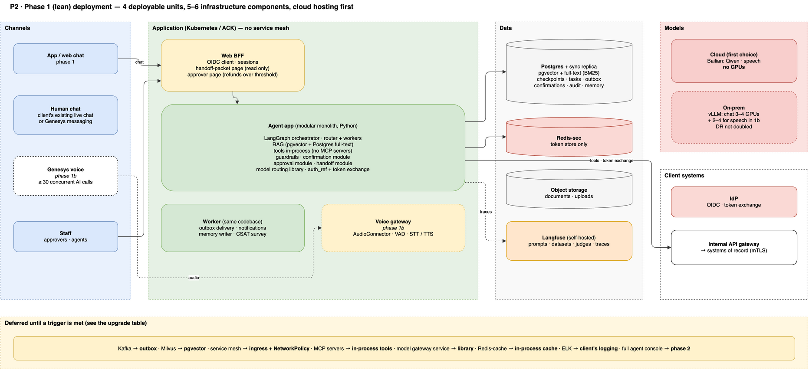

# Customer Support Agent — Phase 1 (Lean) Design

**English** | [中文](README.zh-CN.md) · [Target architecture](../../README.md) · [Update history](../../CHANGELOG.md)

**What this is.** The [target architecture](../../README.md) describes the full platform. This document is what we build **first**: the same agent, the same safety controls, on a deployment sized for the actual load. It can be read on its own; shared specifications (boundaries, data classes, the confirmation contract, failure modes) are **referenced, not copied**, so each rule lives in one place.

**The rule:** phase 1 simplifies **how it is deployed**, never **what it guarantees**.

---

## Contents

1. [Scope](#1-scope)
2. [Load and sizing assumptions](#2-load-and-sizing-assumptions)
3. [Business targets](#3-business-targets)
4. [Architecture](#4-architecture)
5. [Differences from the target architecture and upgrade triggers](#5-differences-from-the-target-architecture-and-upgrade-triggers)
6. [Safety core that is not simplified](#6-safety-core-that-is-not-simplified)
7. [Key flows in phase 1](#7-key-flows-in-phase-1)
8. [Models and GPUs](#8-models-and-gpus)
9. [Testing and release](#9-testing-and-release)
10. [Operations](#10-operations)
11. [Criteria for moving to phase 2](#11-criteria-for-moving-to-phase-2)

---

## 1. Scope

| | Phase 1 | Phase 1b | Phase 2 (target architecture) |
|---|---|---|---|
| Channels | **App and web chat** | + **voice** for the highest-volume intents, **at most 30 concurrent AI calls**; the rest go to IVR or humans | All voice intents; messaging apps (WeChat, WhatsApp, Telegram) per region profile |
| Intents | Product and terms questions (RAG); account and order lookup (read only); **place order, cancel, refund** through the confirmation service | Same, on voice | Account changes with approval; cancellation flows; more domain packs |
| Human side | Handoff to the client's existing human chat (or Genesys messaging), plus a **read-only handoff-packet page**; a minimal **approver page** for refunds over the threshold | Voice handoff to the Genesys ACD queue | Full agent console with 8 panels, supervisor view, agent assist |
| Account changes (T2 drafts) | **Handed off to humans** | Same | Draft + approval ([C4](../../README.md#9-business-flows)) |
| Hosting | **Cloud first** (Bailian in the region profile's region); on-prem if the client requires it | Same | Either |

---

## 2. Load and sizing assumptions

- About **26,000 sessions a day**; at peak about **23 turns per second** (≈ 13 chat + ≈ 10 voice once voice is fully live).
- Phase 1 is chat only: **≈ 13 turns/s at peak**. Phase 1b adds at most 30 concurrent AI calls: **≈ 2.5 voice turns/s**.
- A single Python service with 4–6 pods handles this comfortably; the bottleneck is model serving, not application code.

| Component | Phase 1 starting size |
|---|---|
| Agent app | 4–6 pods × 2 vCPU / 4 GB, horizontal autoscaling |
| Worker | 2 pods |
| Web BFF | 2 pods (or the client's existing app backend) |
| Voice gateway (1b) | 2 pods |
| Postgres | Primary 8 vCPU / 32 GB + **synchronous replica**; managed (ApsaraDB) in the cloud profile |
| Redis-sec | Small HA pair, tokens only |
| Langfuse | Self-hosted, small (its own Postgres, ClickHouse and object storage) |

These are starting points; the first sprint benchmarks them, as in the target architecture.

---

## 3. Business targets

Definitions, formulas and the capacity method are in the target architecture ([Business metrics and cost model](../../README.md#business-metrics-and-cost-model)); these are the phase-1 numbers.

| Metric | Phase 1 (chat) | Phase 1b (voice, top intents) |
|---|---|---|
| Containment, strict | 40–50% at launch; **≥ 60% after 6 months** | 25–35% |
| Handoff rate | ≈ 50% at launch; ≤ 35% after 6 months | ≈ 65% |
| AI cost per session | Baseline measured in shadow mode; **≤ 20% of the human cost per contact** | Same rule |
| Break-even containment | ≈ 20–25% | ≈ 20–25% |
| Agents (illustrative) | Chat: ≈ 107 online without AI → ≈ 55–65 at launch → ≈ 45–55 at 60% | Voice: ≈ 120 scheduled → ≈ 70 |
| Guard metrics | CSAT for AI-only sessions not below the human baseline; 7-day repeat-contact rate not rising | Same |

---

## 4. Architecture

*P2 · Phase 1 deployment — source: [`P2-phase1-deployment.drawio`](../diagrams/P2-phase1-deployment.drawio)*

**Four deployable units** (a modular monolith; module interfaces are written as if they were services, so any module can be split out later with little change):

| Unit | Contains |
|---|---|
| **Agent app** (Python) | LangGraph orchestrator (router + bounded workers); RAG (pgvector + Postgres full-text); **tools called in-process** (no MCP servers); guardrails; **confirmation module**; approval module; handoff module; model routing as a library; `auth_ref` + token exchange |
| **Worker** (same codebase, separate process) | Outbox delivery, notifications, long-term memory writer, CSAT survey |
| **Web BFF** | OIDC client and sessions; read-only handoff-packet page; approver page for refunds over the threshold. Reuse the client's app backend where it exists |
| **Voice gateway** (phase 1b) | Genesys AudioConnector endpoint, VAD, streaming STT and TTS |

**Infrastructure: five or six components.** Postgres (with a synchronous replica), Redis-sec (token store only), object storage, Langfuse, the client's IdP and internal API gateway. Logs go to the client's existing logging platform; metrics to Prometheus and Grafana (or the client's equivalent).

**Network.** Ingress gateway plus Kubernetes NetworkPolicy; no service mesh, because there is almost no east-west traffic between our own services. Calls to the client's systems of record still go through the **internal API gateway**, with mTLS where the client requires it.

---

## 5. Differences from the target architecture and upgrade triggers

| Target architecture | Phase 1 | Upgrade when |
|---|---|---|
| Kafka | **Transactional outbox table in Postgres**, polled by the worker | More than 3–4 consumers, or events must be shared with other systems |
| Milvus | **pgvector + Postgres full-text search** as the BM25 side (Chinese tokenisation via zhparser or pg_search) ([options](../../README.md#54-vector-store-options)) | The RAG gates ([15.4](../../README.md#154-rag-evaluation)) fail on pgvector, or the KB grows past roughly a million chunks |
| Service mesh (Istio / Linkerd) | Ingress + NetworkPolicy; mTLS to the internal API gateway | More than about 10 services, or the client mandates east-west mTLS |
| Separate MCP servers | **Tools in-process**, same tool contracts ([4.6](../../README.md#46-tool-and-api-contracts)) | A second AI application needs the same tools, or tool families need separate certificates |
| Separate model gateway service | A routing **library** inside the agent app (aliases, quotas, cost tags) | Several applications share the models |
| Redis-cache | **In-process cache** with short TTLs | Hit rate or pod count makes a shared cache worthwhile |
| ELK | The client's logging platform (or Loki) | — |
| Full agent console | Existing human chat + read-only handoff-packet page | Phase 2 |
| Chaos Mesh, full red-team tooling | Toxiproxy in tests; promptfoo + manual red team | Phase 2 |
| DR doubled for GPUs | **Not doubled**: DR site falls back to degradation level 3 (humans) or a small pool | Volume or SLA requires it |

Kafka-specific and Milvus-specific failure modes in [Appendix B](../../README.md#appendix-b-failure-modes-and-degradation) are replaced by **outbox-worker lag** (alert; events stay in Postgres) and **Postgres search latency** (alert; fall back to full-text only).

---

## 6. Safety core that is not simplified

Phase 1 implements these exactly as specified in the target architecture:

| Control | Where it is specified |
|---|---|
| Identity: `auth_ref`, token exchange per tool call, tokens never in state, logs or traces | [8.3](../../README.md#83-one-request-end-to-end), [11.5](../../README.md#115-token-store) |
| **T1 writes: prepare → confirm (by the channel) → commit** through the confirmation module | [4.6](../../README.md#46-tool-and-api-contracts), BND-ACT-03 |
| Refunds: rules engine, original payment method only, auto-approval switch | [4.6](../../README.md#46-tool-and-api-contracts), BND-ACT-02 / 05 |
| Data classes C0–C3 and what the model sees | [11.6](../../README.md#116-data-classification-and-what-the-model-sees), BND-DAT-04 |
| Guardrail layers 1–5 | [14](../../README.md#14-guardrails) |
| All scope, action, data and trust boundaries; operational limits | [Appendix A](../../README.md#appendix-a-system-boundaries) |
| Handoff packet: facts from system records, summary labelled | [13.2](../../README.md#132-the-handoff-packet), BND-TRS-08 |
| Approvals: separation of duties, the AI never approves | BND-ACT-04 |
| Per-call records and audit | [17](../../README.md#17-observability-audit-and-per-call-records) |
| Degradation levels and kill switches | [Appendix B](../../README.md#appendix-b-failure-modes-and-degradation) |

---

## 7. Key flows in phase 1

| Flow | Phase 1 behaviour | Reference |
|---|---|---|
| Account or order lookup (chat) | As designed; account summary prefetched after login | [C2, C5](../../README.md#9-business-flows) |
| Place order, cancel order, refund | Prepare → confirm card in chat → commit with `confirmation_id` | [C5, C6](../../README.md#9-business-flows) |
| Refund over the threshold or with risk flags | Draft → approver page in the BFF → the approval module executes | [C6](../../README.md#9-business-flows) |
| Account changes, cancellation of a plan | **Handoff to a human** with the packet | [13](../../README.md#13-human-handoff-and-agent-console) |
| Handoff | Chat thread moves to the client's human chat; the agent opens the read-only packet page by `handoff_id` | [C8](../../README.md#133-routing-and-delivery) |
| Voice (1b) | Highest-volume intents only; over 30 concurrent AI calls → IVR or humans | [7](../../README.md#7-channels-voice-vs-chat) |

---

## 8. Models and GPUs

**Cloud profile (first choice):** Bailian Qwen for the LLMs and Bailian speech in phase 1b. **No GPUs.** Cost follows usage.

**On-prem profile, per site:**

| Workload | Phase 1 (chat) | Phase 1b (+ voice, ≤ 30 calls) |
|---|---|---|
| Answer model | **Qwen3-30B-A3B** (MoE, fast and cheap) if the golden set accepts it, else Qwen3-32B: 2 GPUs | Same 2 GPUs (voice adds ≈ 2.5 turns/s) |
| Qwen3-8B (router + rewrite, checks) + embedding + reranker | 1 GPU, shared | Same |
| STT + TTS | — | 2–4 GPUs (least certain number) |
| Headroom | 0–1 | 1 |
| **Total** | **≈ 3–4 GPUs** | **≈ 5–8 GPUs** |
| DR | **Not doubled**: degradation level 3 (humans) or a 1–2 GPU reduced pool | Same |

---

## 9. Testing and release

The testing approach is the target architecture's ([15](../../README.md#15-evaluation-and-testing)), at a smaller size:

- **Golden set: about 300 cases** (≈ 200 scripted, ≈ 100 simulated), every phase-1 intent and every A.1–A.4 boundary covered.
- **Simulation harness** ([15.3](../../README.md#153-agent-simulation-harness)): nightly, **k = 5, pass^k for safety cases**; the mock backend covers accounts, orders and refunds.
- **RAG test set: about 300 question–evidence pairs** with the same gates ([15.4](../../README.md#154-rag-evaluation)).
- Red team: promptfoo plus a manual round before launch.
- **Shadow mode for 2–4 weeks** before customers see the AI, then a 5% canary ([15.7](../../README.md#157-replay-and-shadow-mode)).
- LLMOps as in [16](../../README.md#16-llmops-git-pipeline-and-langfuse): Git → CI → Langfuse; the release label is read by the routing library, and rollback is a configuration switch.

---

## 10. Operations

- **Observability:** Langfuse for LLM traces and scores; Prometheus and Grafana for health; the client's logging platform for service logs; correlated by `trace_id`.
- **Alerts:** the target architecture's key alerts that apply to chat (citation failures, handoff rate, latency, error rates, cost per conversation, CSAT), plus outbox lag.
- **Kill switches:** per intent, tool and channel, as in [Appendix B](../../README.md#appendix-b-failure-modes-and-degradation).
- **Runbooks:** for the failure modes that exist in phase 1 (no Kafka or Milvus rows).

---

## 11. Criteria for moving to phase 2

- Shadow mode and the first months of production meet the agreed thresholds for task success, correct handoff and citation accuracy, and the [business targets](#3-business-targets): **chat containment (strict) ≥ 60%**, AI cost per session ≤ 20% of the human cost per contact.
- **Zero** boundary violations (A.1–A.4) over the period.
- CSAT for AI-only sessions not below the human baseline.
- Then add components **only when their trigger in [section 5](#5-differences-from-the-target-architecture-and-upgrade-triggers) is met**, and add channels and intents from the target architecture one at a time.
