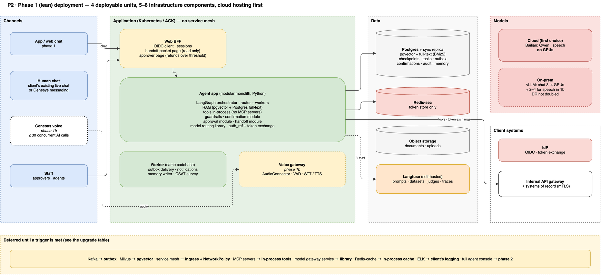

# 客服 Agent —— 第一阶段（精简）设计

[English](README.md) | **中文** · [目标架构](../../README.zh-CN.md) · [更新记录](../../CHANGELOG.md)

**这份文档是什么。** [目标架构](../../README.zh-CN.md) 描述的是完整平台。这份文档描述的是我们 **先做** 的部分：同一个 agent、同样的安全控制，部署规模按实际负载来定。这份文档可以单独阅读；共用的规范（系统边界、数据分级、确认契约、故障模式）**只引用、不复制**，每条规则只在一处维护。

**原则：** 第一阶段精简的是 **怎么部署**，从不精简 **保证了什么**。

---

## 目录

1. [范围](#1-范围)
2. [负载与规模假设](#2-负载与规模假设)
3. [业务目标](#3-业务目标)
4. [架构](#4-架构)
5. [与目标架构的差异及升级条件](#5-与目标架构的差异及升级条件)
6. [不精简的安全核心](#6-不精简的安全核心)
7. [第一阶段的关键流程](#7-第一阶段的关键流程)
8. [模型与 GPU](#8-模型与-gpu)
9. [测试与发布](#9-测试与发布)
10. [运维](#10-运维)
11. [进入第二阶段的条件](#11-进入第二阶段的条件)

---

## 1. 范围

| | 第一阶段 | 第一阶段 b | 第二阶段（目标架构） |
|---|---|---|---|
| 渠道 | **App 和 Web 聊天** | 加上 **语音**，只覆盖量最大的意图，**AI 同时处理的通话最多 30 通**；超出的转 IVR 或人工 | 所有语音意图；按地区形态接入消息应用（微信、WhatsApp、Telegram） |
| 意图 | 产品与条款问题（RAG）；账户和订单查询（只读）；通过确认服务 **下单、取消、退款** | 同上，语音版 | 带审批的账户变更；解约流程；更多行业包 |
| 人工侧 | 转到客户现有的人工聊天（或 Genesys messaging），加一个 **只读的交接包页面**；一个精简的 **审批页面**，用于超过阈值的退款 | 语音转 Genesys ACD 队列 | 8 个区域的完整坐席控制台、主管视图、坐席辅助 |
| 账户变更（T2 草稿） | **转人工处理** | 同左 | 草稿 + 审批（[C4](../../README.zh-CN.md#9-业务流程)） |
| 托管 | **优先云上**（地区形态所在地区的百炼）；客户要求时本地部署 | 同左 | 两者皆可 |

---

## 2. 负载与规模假设

- 每天约 **2.6 万次会话**；峰值约 **每秒 23 轮**（语音全面上线后，约 13 轮聊天 + 约 10 轮语音）。
- 第一阶段只有聊天：**峰值约每秒 13 轮**。第一阶段 b 增加最多 30 通 AI 通话：**约每秒 2.5 轮语音**。
- 一个 Python 服务开 4–6 个 pod 就能轻松处理；瓶颈在模型服务，不在应用代码。

| 组件 | 第一阶段起步规模 |
|---|---|
| Agent 应用 | 4–6 个 pod × 2 vCPU / 4 GB，水平自动扩缩 |
| Worker | 2 个 pod |
| Web BFF | 2 个 pod（或复用客户现有的 App 后端） |
| 语音网关（1b） | 2 个 pod |
| Postgres | 主库 8 vCPU / 32 GB + **同步副本**；云上形态用托管的 ApsaraDB |
| Redis-sec | 小规格高可用一对，只存 token |
| Langfuse | 自托管，小规格（自带 Postgres、ClickHouse 和对象存储） |

这些都是起步值；和目标架构一样，第一个 sprint 做基准测试后再调整。

---

## 3. 业务目标

定义、公式和容量计算方法见目标架构（[业务指标与成本模型](../../README.zh-CN.md#业务指标与成本模型)）；这里是第一阶段的数字。

| 指标 | 第一阶段（聊天） | 第一阶段 b（语音，量最大的意图） |
|---|---|---|
| 自助解决率，严格口径 | 上线时 40–50%；**6 个月后 ≥ 60%** | 25–35% |
| 转人工率 | 上线时约 50%；6 个月后 ≤ 35% | 约 65% |
| AI 单次会话成本 | 影子运行时实测基线；**≤ 人工单次成本的 20%** | 同样的规则 |
| 盈亏平衡的自助解决率 | 约 20–25% | 约 20–25% |
| 坐席（示意） | 聊天：没有 AI 约 107 人在线 → 上线时约 55–65 人 → 60% 时约 45–55 人 | 语音：约 120 人排班 → 约 70 人 |
| 守护指标 | 只有 AI 的会话满意度不低于人工基线；7 天重复联系率不上升 | 同左 |

---

## 4. 架构

*P2 · 第一阶段部署 —— 源文件：[`P2-phase1-deployment.drawio`](../diagrams/P2-phase1-deployment.drawio)*

**四个部署单元**（模块化单体；模块之间的接口按服务的方式来写，以后任何一个模块都能以很小的改动拆出去）：

| 单元 | 包含什么 |
|---|---|
| **Agent 应用**（Python） | LangGraph 编排（路由 + 受限 worker）；RAG（pgvector + Postgres 全文检索）；**工具在进程内调用**（不单独做 MCP server）；护栏；**确认模块**；审批模块；转人工模块；模型路由做成库；`auth_ref` + token exchange |
| **Worker**（同一份代码，单独进程） | Outbox 投递、通知、长期记忆写入、满意度调查 |
| **Web BFF** | OIDC 客户端和会话；只读的交接包页面；超阈值退款的审批页面。客户已有 App 后端的就复用 |
| **语音网关**（第一阶段 b） | Genesys AudioConnector 端点、VAD、流式 STT 和 TTS |

**基础组件：五到六个。** Postgres（带同步副本）、Redis-sec（只存 token）、对象存储、Langfuse、客户的 IdP 和内部 API 网关。日志进客户现有的日志平台；指标进 Prometheus 和 Grafana（或客户的同类工具）。

**网络。** 入口网关加 Kubernetes NetworkPolicy；不用 service mesh，因为我们自己的服务之间几乎没有东西向流量。调用客户业务系统仍然走 **内部 API 网关**，客户要求时用 mTLS。

---

## 5. 与目标架构的差异及升级条件

| 目标架构 | 第一阶段 | 什么时候升级 |
|---|---|---|
| Kafka | **Postgres 里的 transactional outbox 表**，由 worker 轮询 | 消费方超过 3–4 个，或事件要和其他系统共享 |
| Milvus | **pgvector + Postgres 全文检索** 作为 BM25 一侧（中文分词用 zhparser 或 pg_search）（[选项](../../README.zh-CN.md#54-向量库选项)） | pgvector 上 RAG 闸门（[15.4](../../README.zh-CN.md#154-rag-评估)）不通过，或知识库超过约 100 万个切块 |
| Service mesh（Istio / Linkerd） | 入口网关 + NetworkPolicy；到内部 API 网关用 mTLS | 服务超过约 10 个，或客户要求东西向 mTLS |
| 独立的 MCP server | **工具在进程内调用**，工具契约不变（[4.6](../../README.zh-CN.md#46-tool-与-api-契约)） | 有第二个 AI 应用要复用这些工具，或工具族需要各自的证书 |
| 独立的模型网关服务 | Agent 应用内的路由 **库**（别名、配额、成本标签） | 多个应用共用模型 |
| Redis-cache | **进程内缓存**，短 TTL | 命中率或 pod 数量让共享缓存变得值得 |
| ELK | 客户的日志平台（或 Loki） | — |
| 完整坐席控制台 | 现有人工聊天 + 只读交接包页面 | 第二阶段 |
| Chaos Mesh、完整红队工具 | 测试中用 Toxiproxy；promptfoo + 人工红队 | 第二阶段 |
| GPU 灾备翻倍 | **不翻倍**：灾备站点退到降级等级 3（转人工），或保留一个小池子 | 业务量或 SLA 要求时 |

[附录 B](../../README.zh-CN.md#附录-b-故障模式与降级) 里 Kafka 和 Milvus 相关的故障模式，换成 **outbox worker 积压**（告警；事件留在 Postgres）和 **Postgres 检索变慢**（告警；退回只用全文检索）。

---

## 6. 不精简的安全核心

第一阶段完全按目标架构的规定实现以下内容：

| 控制措施 | 在哪里规定 |
|---|---|
| 身份：`auth_ref`、每次工具调用做 token exchange、token 永不进 state、日志或 trace | [8.3](../../README.zh-CN.md#83-一次请求的端到端)、[11.5](../../README.zh-CN.md#115-token-store) |
| **T1 写操作：准备 → 确认（由渠道确认）→ 执行**，通过确认模块 | [4.6](../../README.zh-CN.md#46-tool-与-api-契约)、BND-ACT-03 |
| 退款：规则引擎、只退回原支付方式、自动批准开关 | [4.6](../../README.zh-CN.md#46-tool-与-api-契约)、BND-ACT-02 / 05 |
| 数据分级 C0–C3 与模型可见性 | [11.6](../../README.zh-CN.md#116-数据分级与模型可见性)、BND-DAT-04 |
| 护栏第 1–5 层 | [14](../../README.zh-CN.md#14-护栏-guardrails) |
| 所有业务范围、操作、数据和信任边界；运行上限 | [附录 A](../../README.zh-CN.md#附录-a-系统边界) |
| 交接包：事实来自系统记录，摘要有标注 | [13.2](../../README.zh-CN.md#132-交接包)、BND-TRS-08 |
| 审批：职责分离，AI 永不审批 | BND-ACT-04 |
| 单次调用记录与审计 | [17](../../README.zh-CN.md#17-可观测性审计与调用记录) |
| 降级等级与关闭开关 | [附录 B](../../README.zh-CN.md#附录-b-故障模式与降级) |

---

## 7. 第一阶段的关键流程

| 流程 | 第一阶段的做法 | 参考 |
|---|---|---|
| 账户或订单查询（聊天） | 按原设计；登录后预取账户摘要 | [C2、C5](../../README.zh-CN.md#9-业务流程) |
| 下单、取消订单、退款 | 准备 → 聊天里的确认卡片 → 用 `confirmation_id` 执行 | [C5、C6](../../README.zh-CN.md#9-业务流程) |
| 超过阈值或有风险标记的退款 | 草稿 → BFF 里的审批页面 → 审批模块执行 | [C6](../../README.zh-CN.md#9-业务流程) |
| 账户变更、套餐解约 | 带交接包 **转人工** | [13](../../README.zh-CN.md#13-转人工与坐席控制台) |
| 转人工 | 聊天线程转到客户的人工聊天；坐席按 `handoff_id` 打开只读的交接包页面 | [C8](../../README.zh-CN.md#133-路由与送达) |
| 语音（1b） | 只做量最大的意图；AI 通话超过 30 通 → IVR 或人工 | [7](../../README.zh-CN.md#7-语音与聊天渠道) |

---

## 8. 模型与 GPU

**云上形态（优先）：** LLM 用百炼 Qwen，第一阶段 b 的语音用百炼语音服务。**不需要 GPU。** 成本按用量计算。

**本地形态，每个站点：**

| 负载 | 第一阶段（聊天） | 第一阶段 b（加语音，≤ 30 通） |
|---|---|---|
| 回答模型 | golden set 评估通过就用 **Qwen3-30B-A3B**（MoE，快且便宜），否则用 Qwen3-32B：2 张 GPU | 同样 2 张（语音增加约每秒 2.5 轮） |
| Qwen3-8B（路由 + 改写、检查）+ embedding + 重排 | 共用 1 张 | 同左 |
| STT + TTS | — | 2–4 张（最不确定的数字） |
| 余量 | 0–1 张 | 1 张 |
| **合计** | **约 3–4 张** | **约 5–8 张** |
| 灾备 | **不翻倍**：降级等级 3（转人工），或保留 1–2 张卡的降级池 | 同左 |

---

## 9. 测试与发布

测试方法沿用目标架构（[第 15 节](../../README.zh-CN.md#15-评估与测试)），规模更小：

- **Golden set：约 300 条用例**（约 200 条脚本型、约 100 条模拟型），覆盖第一阶段的每个意图，以及 A.1–A.4 的每条边界。
- **模拟测试框架**（[15.3](../../README.zh-CN.md#153-agent-模拟测试框架)）：每晚运行，**k = 5，安全类用例要求 pass^k**；模拟后端覆盖账户、订单和退款。
- **RAG 测试集：约 300 组问题–证据**，闸门不变（[15.4](../../README.zh-CN.md#154-rag-评估)）。
- 红队：promptfoo，加上线前一轮人工测试。
- **上线前影子运行 2–4 周**，然后 5% canary（[15.7](../../README.zh-CN.md#157-回放与影子运行)）。
- LLMOps 同[第 16 节](../../README.zh-CN.md#16-llmops-git-流水线与-langfuse)：Git → CI → Langfuse；发布标签由路由库读取，回滚就是切一下配置。

---

## 10. 运维

- **可观测性：** LLM trace 和评分用 Langfuse；健康状况用 Prometheus 和 Grafana；服务日志进客户的日志平台；三者用 `trace_id` 关联。
- **告警：** 目标架构中适用于聊天的关键告警（引用失败、转人工率、延迟、错误率、每次对话成本、满意度），再加上 outbox 积压。
- **关闭开关：** 按意图、工具和渠道，同[附录 B](../../README.zh-CN.md#附录-b-故障模式与降级)。
- **处理手册：** 只覆盖第一阶段实际存在的故障模式（没有 Kafka 和 Milvus 那几行）。

---

## 11. 进入第二阶段的条件

- 影子运行和上线后最初几个月，任务成功率、转人工准确率和引用准确率达到约定阈值，并达到[业务目标](#3-业务目标)：**聊天自助解决率（严格口径）≥ 60%**，AI 单次会话成本 ≤ 人工单次成本的 20%。
- 这段时间内边界违规（A.1–A.4）**为零**。
- 只有 AI 处理的会话，满意度不低于人工基线。
- 之后 **只在[第 5 节](#5-与目标架构的差异及升级条件)的升级条件满足时** 才加组件，渠道和意图也从目标架构里一个一个地加。
